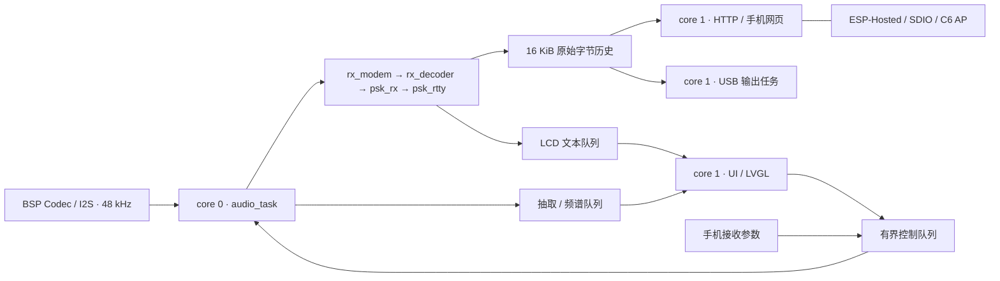

# ESP32-P4 PSK 接收机架构

更新：2026-09-07。当前对外入口是 28 种 PSK/QPSK/8PSK 模式；FT8/FT4、RTTY、CW、MFSK 等旧统一后端代码保留在仓库，本次没有扩展这些模式的产品入口。

## 主要边界

- `audio_input.c` 通过 BSP `esp_codec_dev` 读取音频，48 kHz 经 factor=1 的 DC blocker 送入 modem。音频 task 每块 256 样本，真实采样时间 5.333 ms。
- `rx_modem.c` 是统一 API；`rx_decoder.c` 管后端分发；`psk_rx.c` 管 PSK 配置、调谐和调试快照；`components/psk_rtty` 执行解调与字符解码。
- `psk_modes.c` 是速率、载波数、卷积编码和交织参数来源。新增 HPM 自定义双载波 `2x8PSK1200F`，不意味着兼容 HPM 的图像或 AP580 语音协议。
- `psk_tx.c` 支持有限文本、循环文本和流式字符输入；板上现有 TX 控制仍由独立 TX 任务执行。当前产品目标为接收与显示。
- `transport.c` 只在短临界区向历史缓存复制字节；`rx_history.c` 是纯 C 环形历史。消费者各持游标，客户端断开或慢读不会阻塞音频线程。历史覆盖是有界缓存策略，丢失数必须可见。
- `rx_web.c` 在 core 1 启动 AP/HTTP。HTTP 参数提交只进入控制队列；实际应用由音频任务串行完成。音频线程每次最多处理 4 个控制事件。队列满时 HTTP 返回 503，成功排队返回 202，状态 API 回报实际已应用的值。
- `rx.html` 完全内嵌固件；不用互联网、CDN 或第三方服务。原始数据只通过 `textContent` 显示，不作为 HTML 解释。每次请求都有时限和重试，重启标识避免混淆旧游标。
- USB 镜像使用单独输出任务，可阻塞等待 USB 驱动，无法阻塞音频任务。部分写入/过慢覆盖计数在状态 API 中公开。
- `display.c` 的 LVGL 任务明确固定 core 1；ESP-Hosted 自身系统任务使用组件默认调度。

## API

| 路径 | 方法 | 内容 |
| --- | --- | --- |
| `/` | GET | 离线接收页面 |
| `/api/modes` | GET | 模式 ID 与名称 |
| `/api/status` | GET | 实际模式/频点、理论速率、处理负载、采样/错误统计、heap |
| `/api/rx?cursor=N` | GET | 最多 1024 原始字节；响应头 `X-Next-Cursor`、`X-Lost-Bytes`、`X-Boot-Id` |
| `/api/config` | POST | `application/json`：`{"mode":27,"tone_hz":2000}`；参数校验后排队 |

热点默认 `ESP32P4-PSK` / `pskmodem32`，地址 `192.168.4.1`，最大 4 个客户端。没有 captive portal 自动弹窗。

## 性能和内存

K<=7 的 Viterbi metric 在内部 512 B 工作区；K13/K16 大 metric 与 traceback 在 PSRAM。内部静态内存余量不等于启动后可用 heap。

网页的 DSP 负载以处理时间 / 被处理音频时长计算，不是整个芯片 CPU 占用；最慢块与累计超预算不能单独证明 DMA 无丢样。当前 BSP 不公开硬件 I2S 溢出计数。需要结合 48000 samples/s 的持续采集以及完整载荷对比判断。

评估、验证结果与板上待测边界见 [RATE_AND_AP_2026-09-07.md](docs/RATE_AND_AP_2026-09-07.md)。
